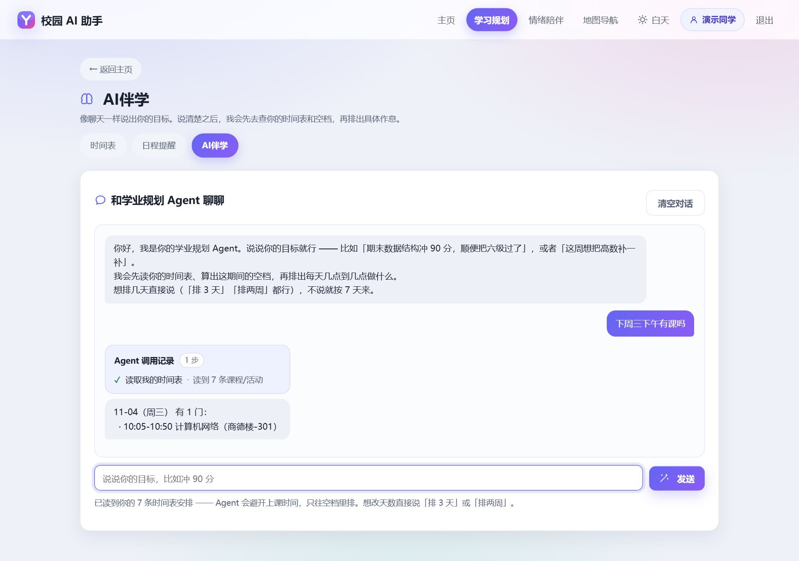
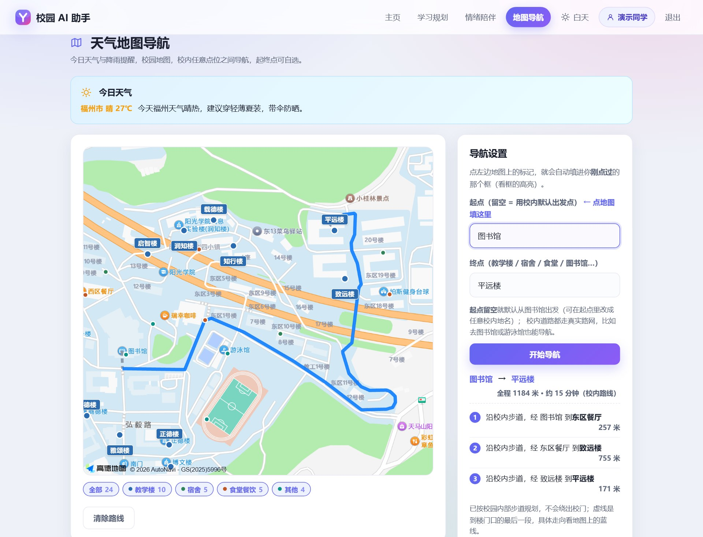
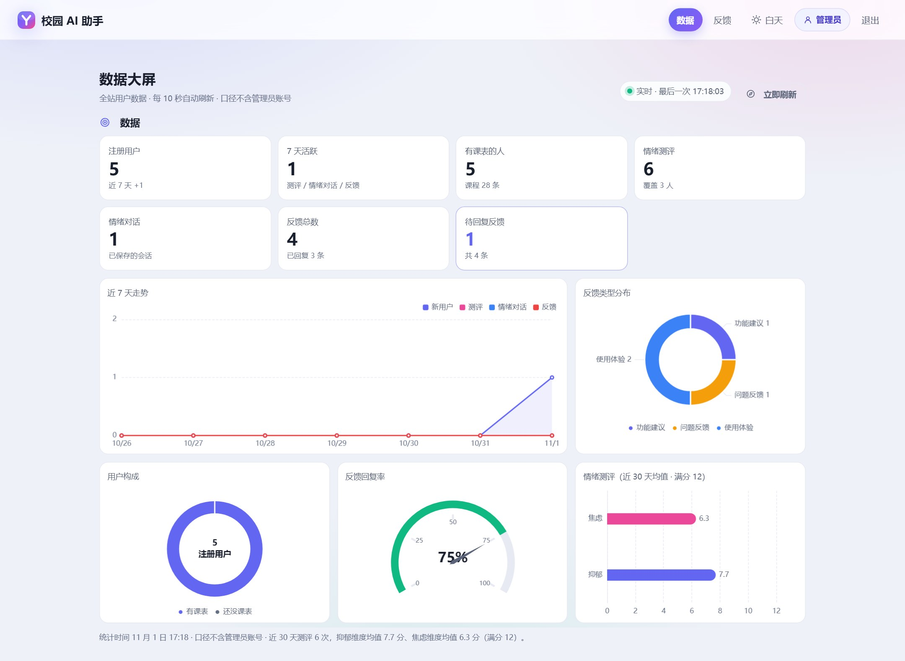

# 校园 AI 助手（Campus AI Assistant）

> 面向在校大学生的校园智能助手：**学习规划 · 学校事务问答 · 情绪陪伴 · 天气地图导航**，一个浏览器页面收齐；另附一套给学校管理员用的数据看板与反馈处理。

<p>
  
  
  
  
</p>

| 项目 | 内容 |
|------|------|
| 在线演示 | https://campus-ai-assistant-61569.app.workbuddy.host/ |
| 评审账号（学生） | `demo` / `demo123456`（已预置 7 条示例课程，登录即可演示） |
| 评审账号（管理员） | `admin` / `zrc666` |
| 构建号 | `2026-11-01-b`（唯一来源 `backend/build.txt`） |
| 运行形态 | 单端口 Web 应用；Windows 双击即用，也可 Docker |

---

## 一、项目介绍

大学生日常处理的信息高度碎片化：课表在教务系统、办事流程散落于教务处官网附件、校园地图将校内小路视为机动车道、情绪困扰缺少出口。单项需求本身并不复杂，但分散在四到五个系统中，且各自需要独立登录与独立入口。

本项目将这些入口收敛为一个：

- **学习规划**——按周次渲染的时间表、Excel / CSV 课表导入（含解析预览）、可调用工具读取真实数据的 AI 排程；
- **学校事务问答**——将学校各部门公开的 29 篇办事指南与校历（教务处 14、图书馆 11、后勤 3、信息化中心 1）构建为可检索知识库，作答时**标注原文出处**，未收录则明确说明；
- **情绪陪伴**——低门槛对话入口（带长期记忆）+ 8 题自评量表（输出分值与分级建议）；
- **天气地图导航**——高德底图 + **自建校园步道路网**，给出校内实际步行路线与里程；
- **管理端**——7 项指标（注册用户、7 天活跃、有课表的人、情绪测评、情绪对话、反馈总数、待回复反馈）与 5 张图表，以及反馈处理列表。

**需求来源**：2026 年 10 月面向本校学生发放匿名问卷（不收集姓名与账号），回收有效样本 53 份——**94.3%** 出门前需确认上课时间与楼栋，**81.1%** 需估算通行时长，**71.7%** 需查看天气；**49.1%** 曾因换课时间估算错误而迟到或险些迟到。

> 设计约束：**需要精确计算的环节一律由代码完成**（周次、节次、里程、时长、分值），大模型仅负责理解意图与组织语言。

---

## 二、功能一览

| 模块 | 能力 | 页面 |
|------|------|------|
| 学习规划 | 学期课表（按周渲染、周次条 1–20 周）、新增课程与活动、Excel / CSV 导入（含预览确认）、按教学楼切换南北区作息、AI 生成计划 | `planner.html` `plan.html` `reminder.html` |
| 学校事务问答 | 29 篇语料的向量检索、三道反幻觉闸、答案带原文出处 | `plan.html`（对话内） |
| 情绪陪伴 | AI 倾听对话（带长期记忆）、8 题测评、结果分级与建议 | `emotion-chat.html` `emotion-quiz.html` `emotion-result.html` |
| 地图导航 | 校园点位、起终点步行路线（自建路网）、文字指引、天气提示 | `nav.html` |
| 账号 | 注册 / 登录 / 扫码登录、改昵称、改密码、注销（级联删数据 + 清向量记忆） | `login.html` `account.html` `scan-confirm.html` |
| 反馈 | 学生提交反馈、查看自己的历史 | `feedback.html` |
| 管理端 | 数据看板（ECharts）、反馈处理 | `admin.html` `admin-feedback.html` |

首页 `index.html` 为三张功能卡 + 三项统计（本周课程、教学楼 / 点位、今日课程）。

### 界面预览

下图为本地真实运行截图（`demo` 账号，浅色主题）：

| 首页：三张功能卡 + 今日一览 | AI 伴学：先出调用记录，再给结论 |
|---|---|
|  |  |

| 地图导航：自建路网、全程里程、分段指引 | 管理端：数据看板与反馈处理 |
|---|---|
|  |  |

> AI 伴学截图中可见「Agent 调用记录 · 1 步：读取我的时间表」，即模型先读取课表数据再作答；
> 而「下周三下午有课吗」这类可直接计算的问题由本地规则处理，**不调用模型**，毫秒级返回。

---

## 三、技术架构

### 3.1 分层

| 层 | 组成 | 说明 |
|----|------|------|
| 表现层 | 14 个静态页面（原生 HTML/CSS/JS） | 零构建、零依赖；一套设计令牌支持浅色/黑夜/护眼三主题 |
| 接口层 | FastAPI 6 组路由：`auth` `planner` `emotion` `map` `feedback` `admin` | Pydantic 校验、JWT 鉴权 |
| 服务层 | `study_agent`（6 只读工具 + 六类路由）、`rag_docs`、`vision`、`timetable_excel`、`glm`、`qdrant`、`amap`、`usage`、`data_export`、`scan_login` | 外部服务全部可缺，缺则降级 |
| 数据层 | SQLite（可切 MySQL）+ Qdrant（可选） | 6 张表；两个向量集合：`campus_docs` / `emotion_memory` |

### 3.2 技术栈与选型理由

| 选择 | 理由 |
|------|------|
| FastAPI | 模型调用是长 IO，需要原生 async；`uvicorn` 单命令起服务 |
| SQLite | 零安装、单文件可迁移；保留 `DATABASE_URL` 切 MySQL 的能力 |
| 原生多页面 | 评审不需要装 Node.js、不需要 `npm install`；打开源码就能读懂 |
| 智谱 GLM-4-flash | 官方承诺永久免费不限量（评审零成本复现）；OpenAI 兼容，换模型改一行 `.env` |
| 手写 RAG（不引框架） | 流程只有四步，但检索后要插入三道自定义反幻觉闸；`rag_docs.py` 约 240 行，每行都能解释 |
| Qdrant | 托管有免费额度、可本机 Docker；payload 过滤方便；缺失只降级两个功能 |
| 高德地图 | 校园矢量底图可截取（自建路网的几何来源）；步行规划可作对照基准 |

### 3.3 目录结构

```
.
├── backend/                  # FastAPI 后端
│   ├── main.py               # 入口：路由注册 + 静态托管 + 启动初始化
│   ├── config.py             # 全部配置（.env 优先）
│   ├── database.py           # 引擎 / 建表 / 启动初始化（建账号、写时间槽）
│   ├── seed.py               # 时间槽种子 + 管理员 + 评审演示账号
│   ├── models/               # orm.py（6 张表）+ schemas.py（请求/响应模型）
│   ├── routers/              # auth / planner / emotion / map_weather / feedback / admin
│   ├── services/             # study_agent / rag_docs / vision / timetable_excel /
│   │                         #   glm / qdrant / amap / usage / data_export / scan_login
│   └── data/campus_docs/     # 29 篇校内文档语料（每篇带原文链接与抓取日期）
├── frontend/                 # 纯静态前端（零构建）
│   ├── *.html                # 14 个页面
│   ├── css/style.css         # 设计系统（令牌 + 三主题 + 响应式）
│   ├── js/                   # 页面逻辑 + 公共模块
│   │                         #   campus-graph.js：校园步道路网 + Dijkstra（导航页）
│   └── vendor/               # 本地第三方（ECharts 等），不依赖 CDN
├── tools/                    # 18 个 test_* 脚本 + 构建/编码/路网工具
├── Dockerfile                # 非 root 运行 + HEALTHCHECK
├── start-windows.bat         # Windows 一键启动（装依赖 + 挑局域网 IP + 自测）
└── docs/                     # 技术文档（md + pdf）与操作手册 PDF
```

> 上面是**仓库**结构。

### 3.4 四个关键设计

1. **能算的不调模型**——第几周、空档、里程、分数、"学校有几个楼"全在本地算，毫秒级且不会算错。
2. **只读工具**——6 个 function calling 工具全部只读，模型无法写库，排程不会污染真实课表。
3. **三道反幻觉闸**——手册问答在检索后插入确定性判据：分数不够不调模型、动作词缺失直接拦住、对象张冠李戴直接拦住。
4. **零 Key 可运行**——缺 GLM / Qdrant / 高德任一，只降级对应功能，页面不白屏。

---

## 四、快速开始

### 方式一：Windows 一键（推荐给评审）

```text
解压 → 双击 start-windows.bat → 浏览器自动打开
```

脚本会自动检测 Python、安装缺失依赖、挑一个可用的局域网 IP、做一次自测。首次启动会建库、写时间槽、创建管理员与演示账号。

### 方式二：Docker

```bash
docker build -t campus-ai .
docker run --rm -p 3000:3000 --env-file backend/.env campus-ai
# 打开 http://127.0.0.1:3000/app/login.html
```

镜像基于 `python:3.13-slim`，以非 root 用户 `campus(10001)` 运行，自带 `HEALTHCHECK`（打 `/api/ping`）。`.dockerignore` 已排除 `.env`、`campus_ai.db`、`data_export/`。

### 方式三：手动

```bash
python -m pip install -r backend/requirements.txt

# 后端（同时托管前端）
cd backend && PORT=3000 python main.py
# 打开 http://127.0.0.1:3000/app/

# 只想跑前端静态（需后端另起）
cd frontend && python -m http.server 5500
```

### 首次启动做了什么

1. 建库（SQLite，`backend/campus_ai.db`）；
2. 写 18 个时间槽（06:00–23:00，含南北区作息）；
3. 创建管理员 `admin` / `zrc666`（`is_admin=1`，登录后直接进数据大屏）；
4. 创建评审演示账号 `demo` / `demo123456`，并预置 **7 条示例课程**（周一到周五，任何一天打开都有课）；
5. 语料不自动导入——需要使用手册问答时手动执行一次（见 5.4）；未导入时功能仍可用，检索为空并回答"手册未收录"。

两个账号均为**幂等创建**：已存在则跳过，不重置密码，不覆盖已修改的课表。将 `ADMIN_USERNAME` 或 `DEMO_USERNAME` 置空即不创建对应账号。

---

## 五、环境配置

### 5.1 环境变量

完整模板见 **`backend/.env.example`**，复制为 `backend/.env` 后按需填写。**所有 Key 都可以留空**，留空时对应功能自动降级为提示文案，项目仍能完整跑通。

```bash
copy backend\.env.example backend\.env      # Windows
cp backend/.env.example backend/.env        # Linux / macOS
```

| 变量 | 必填 | 作用 | 缺失时 |
|------|------|------|--------|
| `GLM_API_KEY` | 否 | 学习规划、情绪对话、文档问答 | 降级：本地规则计划 / 固定话术 |
| `GLM_MODEL` | 否 | 对话模型名，默认 `glm-4-flash` | — |
| `GLM_BASE_URL` | 否 | 模型服务地址（OpenAI 兼容，换供应商只改这一行） | 用内置默认值 |
| `QDRANT_URL` / `QDRANT_API_KEY` | 否 | 文档检索与情绪长期记忆 | 降级：无记忆、文档问答不可用 |
| `AMAP_WEB_KEY` | 否 | 后端：天气、地理编码 | 降级：天气与地理编码不可用 |
| `DATABASE_URL` | 否 | 默认 SQLite；可填 MySQL | 用 `backend/campus_ai.db` |
| `PORT` / `API_PORT` | 否 | 后端监听端口；查找顺序 `CAMPUS_API_PORT` → `PORT` → `API_PORT` → 8000 | 用默认值 8000 |
| `WEB_PORT` | 否 | 仅「前端单独起静态服务器」时用（后端另起） | 用默认值 5500 |
| `SECRET_KEY` | 建议 | 登录令牌签名 | 使用内置默认值（仅演示可接受） |
| `ADMIN_USERNAME` / `ADMIN_PASSWORD` | 否 | 管理员账号，默认 `admin` / `zrc666` | 配空 = 不建管理员 |
| `DEMO_USERNAME` / `DEMO_PASSWORD` | 否 | 评审演示账号，默认 `demo` / `demo123456` | 配空 = 不建演示账号 |

前端另有 `frontend/js/config.js`：`AMAP_JS_KEY`（JS API Key）、`AMAP_SECURITY_CODE`（同一 Key 的安全密钥）、`CITY_ADCODE`（城市编码，不是 Key）。地图相关共三个 Key：**后端 `AMAP_WEB_KEY` 一个，前端两个**，两边各填各的，不要混填。

### 5.2 依赖清单

`backend/requirements.txt`（完整注释见文件内）：

```
fastapi
uvicorn[standard]
sqlalchemy
PyJWT
python-multipart
pydantic-settings
httpx
xlrd
openpyxl
qdrant-client        # 可选，缺失只降级检索与记忆
# pandas             # 可选，缺失时解析器走 xlrd/openpyxl 直读
```

前端零依赖：无 `package.json`、无构建步骤。

### 5.3 Key 从哪里申请

| 服务 | 地址 | 说明 |
|------|------|------|
| 智谱 GLM | https://open.bigmodel.cn | 实名后创建 API Key；`glm-4-flash` 免费 |
| 高德开放平台 | https://console.amap.com | 需要「Web 服务」Key（后端）与「JS API」Key（前端） |
| Qdrant | https://cloud.qdrant.io | 有免费额度；也可本机 `docker run -p 6333:6333 qdrant/qdrant` |

### 5.4 导入校园文档语料（只用文档问答才需要）

```bash
cd backend
python -m services.rag_docs --dry-run   # 先看会切多少块，不写库
python -m services.rag_docs             # 写入 Qdrant 的 campus_docs 集合
```

语料位于 `backend/data/campus_docs/`（教务处 / 图书馆 / 后勤 / 信息化中心公开的办事指南与校历，共 29 篇），每篇开头标注原文链接与抓取日期。**不导入不影响运行**：检索为空时回答"手册未收录"，不生成流程内容。

### 5.5 安全说明

- `.env` 被 `.gitignore` 排除，**仓库里只有 `.env.example`（全部留空）**；
- 数据库 `campus_ai.db`、数据导出目录 `data_export/`、`__pycache__` 均不进仓库、不进镜像；
- 交付压缩包内的 `.env` 为演示配置，请勿转发到公开渠道。

---

## 六、怎么用

### 学生端

| 目标 | 操作 |
|---------|--------|
| 查看本周时间表 | 顶栏「学习规划」→ 时间表视图，通过周次条切换周次 |
| 导入课表 | 时间表页「导入」→ 上传教务系统导出的 Excel（.xls / .xlsx）或 CSV，解析结果先预览、确认后写入 |
| 询问"下周三下午有课吗" | 「学习规划」→ AI 伴学，直接提问；回答前展示工具轨迹 |
| 询问"休学需要准备哪些材料" | AI 伴学直接提问；答案含原文出处，未覆盖时明确说明"手册未收录" |
| 生成复习计划 | AI 伴学 → 说明目标与天数 → 计划按空档排布，避让上课时间 |
| 查询路线 | 顶栏「地图导航」→ 起点留空则默认从图书馆出发，终点可在地图或列表中选择 |
| 情绪疏导 | 首页「情绪陪伴」→ AI 对话 或 8 题测评 |
| 提交反馈 | 首页或账号页进入「反馈」 |

> 地图导航**不使用浏览器定位**（校园场景下定位偏差常达数百米，精度低于手动选择）。起点留空时以校内默认出发点图书馆计算，并将该名称写回输入框；其他起点可在起点输入框中选择任意校内地点。

### 管理端

用 `admin` 登录后进入独立视角（顶栏只留「数据 | 反馈」）：

- **数据**：注册用户、近 7 日活跃、有课表的人、情绪对话量、测评分布、反馈类型分布；
- **反馈**：按状态筛选、查看与处理。

---

## 七、测试与评测

| 想做 | 命令 | 说明 |
|------|------|------|
| 后端契约 | `python tools/test_rag_docs.py`（另有 `test_study_agent.py` / `test_scan_login_contract.py` / `test_data_export.py`） | 脚本式，自带「结论: N 通过 / M 失败」与退出码 |
| 前端纯逻辑 | `node tools/test_term_timetable.mjs`（按周判断）等 | 不起服务、不开浏览器，秒级 |
| 全站 e2e | `node tools/test_site_smoke.mjs` | 逐页打开，断言无控制台错误、无白屏 |
| 无障碍 | `node tools/audit_a11y.mjs` | axe-core 扫 WCAG 2.1 A/AA，浅色 + 黑夜两轮 |
| 路网质量 | `python tools/qa_campus_graph.py` | 把路线投到底图路像素上量离路距离；需额外 `pip install numpy scipy pillow` |
| Agent 路由评测 | `python tools/eval_agent.py` | 离线，只跑路由函数，秒级不花钱 |
| Agent 端到端 | `python tools/eval_agent.py --live` | 真跑接口，单条不超过 50 秒（受总预算约束） |

共 18 个 `test_*` 脚本。CI 配置在 `.github/workflows/ci.yml`：后端契约 + 覆盖率、前端静态守卫、e2e + 无障碍、镜像构建。

### 7.1 一个关键实现细节：课表按「周次」存，不按日期铺开

课程只存**星期几 + 生效周次**，某天有没有课由「星期相同 **且** 该天周次落在区间内」实时判断。单双周、前后八周、临时调课都不需要改数据，换学期须同步前后端两处开学日常量，由守卫测试校验两侧一致。

代价是判断口径必须唯一：全站只允许一处「某天有没有这门课」的实现（`coursesOnDate`），任何页面都不得拿日期自行比较——课表里的 `date` 只说明它是星期几，不说明它在哪一周。同一条判据写两遍，容易漏改其中一处。

---

## 八、开发过程

- **提交历史**：仓库保留完整的开发提交记录，每次改动都对应一个可运行的构建号（`YYYY-MM-DD-x`）；
- **构建号唯一来源**：`backend/build.txt`，由 `tools/bump_build.py` 一处输入、全站同步（含 14 个页面的 `?v=` 与登录页页脚），`--check` 可校验一致性；
- **CI**：任何推送都会跑后端契约、前端守卫、e2e 与无障碍；被新提交取消的旧轮次标 cancelled，不算失败；
- **文档**：`docs/技术文档.pdf`（八章，含 AI 技术方案与创新点，共 24 页）；`docs/使用说明.pdf` 为 17 页操作手册，含启动方式与各页面使用说明。

---

## 九、团队信息

<!-- TEAM:BEGIN 公开仓库不展示成员个人信息；提交包由 gtest/fill_team.py 替换本段 -->
| 项 | 内容 |
|----|------|
| 学校 / 学院 | 阳光学院 |
| 团队名称 | 铁人队 |
| 成员 | 见提交材料 |
| 指导教师 | 见提交材料 |
| 联系方式 | 见提交材料 |
<!-- TEAM:END -->

---

## 十、说明

- 本项目为竞赛参赛作品，代码与文档仅用于评审与学习交流；
- 校内点位坐标、路网几何来自公开地图数据的标定；文档语料来自学校教务处公开页面（每篇标注原文链接与抓取日期）；
- 情绪测评是筛查工具，不构成医学诊断。
