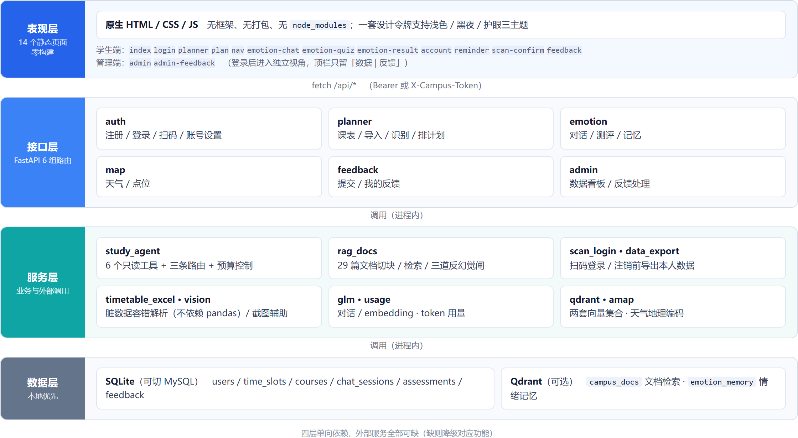
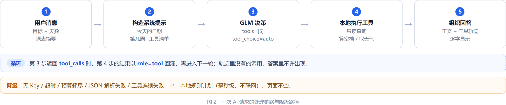
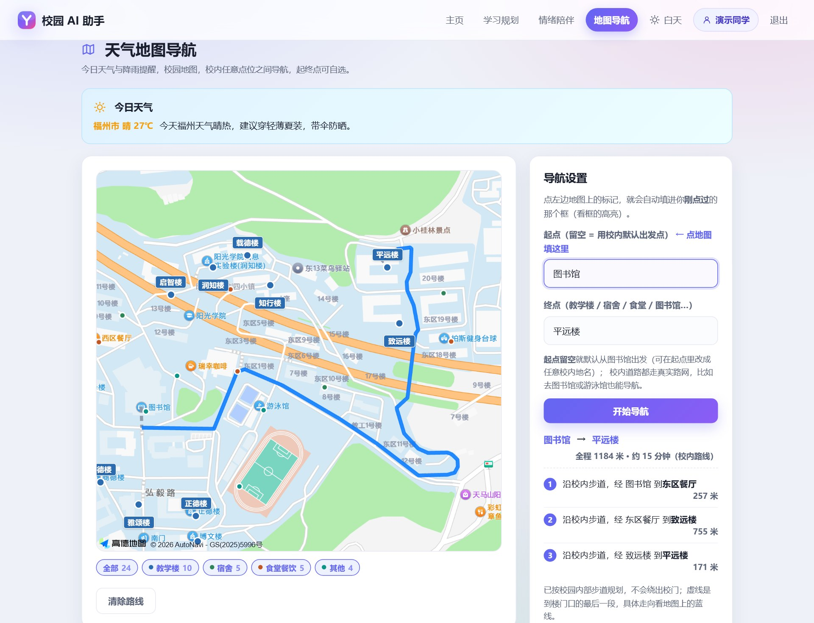
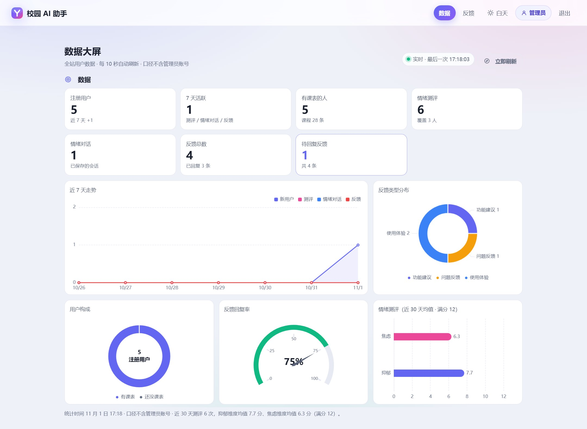

# 校园 AI 助手 · 技术文档

**传智杯 AI Web 竞赛参赛作品**

| 项目 | 内容 |
|------|------|
| 作品名称 | 校园 AI 助手（Campus AI Assistant） |
| 参赛单位 | 阳光学院 |
| 团队名称 | 铁人队 |
| 团队成员 | 见提交材料 |
| 指导教师 | 见提交材料 |
| 联系方式 | 见提交材料 |
| 构建号 | 2026-11-01-b |
| 在线演示 | https://campus-ai-assistant-61569.app.workbuddy.host/ |
| 评审账号 | 学生 `demo` / `demo123456`；管理员 `admin` / `zrc666` |
| 代码仓库 | https://github.com/1280507078/campus-ai |

---

## 一、项目概述

### 1.1 作品定位

校园 AI 助手是一个面向在校大学生的 Web 应用。它将四项高频需求收敛至同一浏览器入口，此前这些需求分散在四至五个相互独立的系统中：

- **学习规划**：按周次渲染的时间表、Excel / CSV 课表导入（含解析预览），以及可调用工具读取真实数据的 AI 排程；
- **学校事务问答**：将学校各部门公开的 29 篇办事指南与校历（教务处 14、图书馆 11、后勤 3、信息化中心 1）构建为可检索知识库，回答"休学需准备哪些材料""校园卡遗失如何补办"等问题，并**标注原文出处**；
- **情绪陪伴**：低门槛对话入口，带长期记忆；8 题自评量表，输出分值与分级建议；
- **天气与地图导航**：高德底图叠加**自建校园步道路网**，给出校内两地之间的实际步行路线与里程，并附当日天气提示。

此外提供一套面向学校管理员的数据看板与反馈处理页面。

界面统一使用「时间表」这一名称：该页除课程外还承载活动与自习安排。本文指代界面与功能时用「时间表」，指代教务系统导出的原始表格、导入文件或课程数据时用「课表」。

本作品不采用通用对话界面的封装形式。所有涉及精确计算的环节（周次、节次、里程、时长、分值）均由代码完成，大模型仅承担意图理解与语言组织。该边界贯穿全文，是首要设计约束。

### 1.2 交付形态

| 维度 | 选择 | 理由 |
|------|------|------|
| 部署单元 | 单端口（后端同时托管前端静态文件） | 评审无需启动两个服务，也无需处理跨域 |
| 前端 | 原生多页面（HTML/CSS/JS），**零构建** | 无需 Node.js，无需 `npm install`，解压即用 |
| 数据库 | SQLite（可切 MySQL） | 零安装；单文件可迁移 |
| 启动 | `start-windows.bat` / `Dockerfile` | 本地一键启动；服务器单条 `docker build` |
| 外部服务 | GLM / 高德 / Qdrant，**均可缺失** | 任一缺失只降级对应功能，页面不空白 |

下图为本地真实运行截图（`demo` 账号，浅色主题）：


首屏未放置对话输入框，以三张功能卡与三项统计（本周课程、教学楼、今日课程）呈现当前状态，对话入口置于「学习规划」内。依据见 2.1：94.3% 的受访者每日首个信息需求是"几点上课、在哪栋楼"，该项信息不需要模型生成，也不需要键盘输入。

### 1.3 规模与质量

| 指标 | 数值 |
|------|------|
| 后端 Python | 约 1.07 万行（FastAPI + SQLAlchemy） |
| 前端 JS | 9,418 行（不含第三方 vendor） |
| 前端 CSS | 2,951 行（一套设计令牌，浅色 / 黑夜 / 护眼三主题） |
| 测试与工具脚本 | 约 7,900 行 / 18 个 `test_*` 脚本 |
| 页面 | 14 个（多页面，非单页路由） |
| 后端接口组 | 6 组（auth / planner / emotion / map / feedback / admin） |
| AI 工具（function calling） | 6 个，全部只读 |
| 知识库 | 29 篇校内文档 → 向量检索（400 字/块，60 字重叠） |
| 自建校园路网 | 172 个节点 / 205 条路段 / 590 个折线中间点 |
| 时间槽 | 18 个（06:00–23:00，按学校实际节次） |
| 测评量表 | 8 题（4 项抑郁 + 4 项焦虑，4 级计分） |

### 1.4 文档结构

第二章说明需求来源；第三章给出架构与选型；**第四章为 AI 技术方案（选型理由、集成方式、优化策略）**；第五章说明核心功能实现；第六章说明测试与部署；第七章总结；**第八章单列创新点**。附录给出环境配置、依赖清单与评审指引。

| 大赛材料 | 对应位置 |
|---------|---------|
| 技术文档 | 本文件（包根目录 `技术文档.pdf`） |
| 代码仓库 | `https://github.com/1280507078/campus-ai`，含 README 与提交历史 |
| 在线演示 | 封面所列地址，评审账号见封面 |
| 演示视频 | 独立提交；内容对应第 5 章功能演示与第 8 章创新点 |

---

## 二、需求分析

### 2.1 调研方法与样本

2026 年 10 月 17—25 日面向本校学生发放匿名问卷，不收集姓名与账号，回收有效样本 **53 份**（大三占 77.4%，其余为大一大四及其他年级）。问卷仅采集行为频次，不设态度类设问，以避免引导性作答。

主要结果：

| 问题 | 结果 |
|------|------|
| 出门前确认"今天几点上课、在哪栋楼" | **94.3%** |
| 估算"从宿舍走过去大概多久" | **81.1%** |
| 查看"今天是否下雨、是否需要带伞" | **71.7%** |
| 上述三项的人均勾选数 | **2.5 项**（131 项次 ÷ 53 人） |
| 换课途中"时间估算错误，迟到或险些迟到" | **49.1%** |
| 其中"几乎每周发生" | **15.1%** |

该结果直接决定首屏结构：优先呈现课程数据与功能入口，而非构建对话入口；AI 用于补充页面上无法直接呈现的信息。

### 2.2 办事流程：一项被低估的需求

在问卷之外，对学校各部门官网面向学生的公开页面逐项清点，共 **29 篇**办事指南与校历（教务处 14、图书馆 11、后勤 3、信息化中心 1）。这批材料的共同特征是：内容准确，但学生缺乏检索动机与检索路径。

该类需求与课程查询存在本质差异：

| | 课程查询 | 办事流程咨询 |
|---|--------|-----------|
| 答案所在 | 数据库，结构固定 | 自然语言文档 |
| 出错代价 | 看错一节课 | 按虚构流程往返一次 |
| 正确的"不知道" | 少见 | **常见**（29 篇未覆盖的问题多于已覆盖的） |

因此该模块的目标不是提高回答数量，而是**保证准确性，并在无依据时明确说明未收录**。

### 2.3 需求归纳

| 需求 | 现象 | 现有工具的不足 | 本项目的应对 |
|------|------|-------------------|--------------|
| 时间表需按周查看 | 课程并非每日相同，单双周、前后八周差异显著 | 教务系统导出整学期大表，移动端难以辨认 | 周次模型（锚点 + 偏移），按周渲染与判断 |
| 路线需在校内 | 公共地图按机动车路网计算，不识别校内步道 | 知行楼→平远楼：高德 1,675 m（绕出校门），校内实际步行 680 m | 自建步道图 + Dijkstra |
| 问句需可作答 | 查询课程、楼栋、天气需切换多个应用 | 通用助手无法获取用户课表 | 工具调用：先取真实数据，再组织语言 |
| 流程需可溯源 | 办事指南散落于官网附件 | 通用模型易生成看似可信但无出处的流程 | 29 篇语料 + 三道反幻觉闸 + 标注出处 |
| 情绪需有出口 | 情绪低落时不愿向熟人倾诉，也不愿填写长问卷 | 心理中心存在使用门槛；通用助手无记忆、无分级 | 低门槛对话 + 长期记忆 + 自评量表 |

### 2.4 非功能需求

以下五项列入验收标准，不作为附带目标：

1. **零 Key 可运行**：评审无需申请任何 API Key，即可打开全部页面并查看全部界面。缺失 Key 仅降级对应功能，不报错、不空白。
2. **零构建**：不要求评审安装 Node.js。前端为纯静态文件，后端启动后即可访问。
3. **隐私最小化**：问卷匿名；对话内容仅用于本人回看；`campus_ai.db` 与导出数据不进入仓库与交付包。
4. **移动端可用**：320 / 375 / 390 三档实测，顶栏、表格、地图均无横向溢出。
5. **可解释**：每次工具调用渲染为时间线，每条手册答案携带原文出处。

---

## 三、系统架构设计

### 3.1 总体架构

系统分为四层，层间仅通过明确定义的接口通信：



服务层的 `vision` 为课表导入的**辅助通道**：拍照或截图先转换为二维网格，再进入与 Excel 相同的预览页。产品主路径为 Excel / CSV 结构化解析。课表本身存在电子版本，将确定性数据转为图像识别属于精度降级，故仅作为补充手段。两条通道最终均停在「预览确认后才写库」这一步，辅助通道的识别误差不会直接写入课表。

**多页面而非单页应用的取舍**：本项目共 14 个页面，共享一套 CSS 与 3 个公共脚本（`common.js` / `config.js` / `icons.js`，每页均引用）。采用单页框架需引入构建链（Node、打包器、路由库），其收益主要是"切页不闪白"。在"评审须能一键启动"这一约束下，零构建的价值高于单页切换的流畅度。跨页过渡使用 View Transition（Chrome 126+ 生效，其余浏览器忽略），不引入额外依赖。

### 3.2 技术选型与理由

| 选择 | 备选 | 选择理由 |
|------|------|-----------|
| FastAPI | Flask / Django | 原生 async（模型调用为长 IO，同步框架会阻塞进程）；Pydantic 自动校验请求体；`uvicorn` 单命令启动 |
| SQLite | MySQL / PostgreSQL | 单文件、零安装、可直接迁移；当前并发量级完全够用，保留 `DATABASE_URL` 切换 MySQL |
| 原生多页面 | Vue / React | 见 3.1；源码无需框架背景即可阅读 |
| GLM-4-flash | GPT / Claude / 本地模型 | 官方承诺永久免费且不限量，评审可零成本复现；中文理解与工具调用满足需要；兼容 OpenAI 协议，更换模型仅需修改 `.env` 一行 |
| **自实现 RAG** | LangChain / LlamaIndex | 全流程仅"切块 → 向量化 → 检索 → 拼接"四步，框架的抽象成本高于收益；且检索后需插入三道自定义反幻觉判据，框架会形成阻隔 |
| Qdrant | FAISS / pgvector | 托管版有免费额度，亦可本机 Docker 部署；payload 过滤较 FAISS 方便；缺失时仅降级情绪记忆与手册问答 |
| 高德 JS / Web 服务 | 百度 / 腾讯地图 | 校园矢量底图可截取，作为自建路网的几何来源；步行规划可作为对照基准 |

### 3.3 数据模型

| 表 | 作用 | 关键约束 |
|----|------|---------|
| `users` | 账号、昵称、密码哈希、管理员标记 | `username` 唯一 |
| `time_slots` | 18 个时间槽（06:00–23:00） | 南北区作息各一套 |
| `courses` | 课程：名称、教师、楼栋、教室、星期、节次、周次 | `uq_user_date_slot`（同一用户同一格不重复） |
| `chat_sessions` | 情绪对话记录（一问一答一条） | 仅存当轮，不存整段 |
| `assessments` | 测评结果（分值、分级、时间） | 分值由后端计算 |
| `feedback` | 用户反馈（类型、内容、处理状态） | 管理端按状态筛选 |

六张表以 `users.id` 为轴：`courses` / `chat_sessions` / `assessments` / `feedback` 各带一个 `user_id` 外键；其余为字典表与记录表。

**注销须同时清理向量数据**：SQLite 的 `users.id` 未设置 `AUTOINCREMENT`，被删除的 ID 会被后续注册者复用。若仅删除表内记录而不清理 Qdrant 的 `emotion_memory`，新用户首次对话可能检索到上一位用户的情绪记忆。因此注销流程为「导出 → 删除表记录 → 删除两个集合中该用户的向量」三步，缺任一步即构成隐私缺陷。

时间表**不存储"某天的课"**，仅存储"星期几 + 生效周次"，该模型是时间表模块的基础（见 5.1）。

### 3.4 一次 AI 请求的链路

以"排一份本周复习计划"为例：

1. 前端 `plan.html` 收集目标文本、天数、当前课表摘要，POST `/api/planner/plan`；
2. 后端 `routers/planner.py` 校验登录态，交由 `study_agent` 分派；
3. **入口分派**决定走向：寒暄短路，其余归入六类路由，仅文档问答 / 学习教练 / 规划 Agent 调用模型（见 5.2）；
4. 规划 Agent 构造系统提示（含**当天日期**、用户课表、6 个只读工具），进入多轮循环；
5. 模型调用 `get_timetable` 取得真实课程，再调用 `find_free_slots` 计算空档，生成计划；
6. 每轮的工具名、参数、返回摘要写入 `trace`，随结果返回；
7. 前端将 `trace` 渲染为时间线，计划正文逐字显示；
8. 任一步失败（超时 / 额度 / 解析失败）即降级至**本地规则计划**（毫秒级、不联网），页面不空白。

---

## 四、AI 技术方案

### 4.1 AI 能力全景

本项目使用四处 AI，职责边界明确：

| 能力 | 模型 | 输入 | 输出 | 兜底 |
|------|------|------|------|------|
| 学习规划 Agent | GLM-4-flash（工具调用） | 目标 + 课表 + 日期 | 计划文本 + 工具轨迹 | 本地规则计划 |
| 学校文档问答 | GLM-4-flash + embedding | 问题 + 检索片段 | 答案 + 出处 | 明确回答"手册未收录" |
| 情绪陪伴 | GLM-4-flash + embedding | 消息 + 相关记忆 | 回复 | 固定关怀话术 |
| 天气提示 | GLM-4-flash（可选） | 天气 JSON | 一句出行建议 | 直接展示温度与降水原始值 |

**不由 AI 承担的职责**同样明确：周次、空档、里程、分值、片段中是否含指定动作，全部由代码计算（见 4.5 第 1 条）。

### 4.2 选型理由

**选择 GLM-4-flash 的依据**

- **成本**：官方承诺永久免费且不限量。需要付费 Key 才能演示的方案，在评审环境中不具备可用性。
- **能力匹配**：模型承担的任务仅三类——理解中文意图、选择工具、组织通顺语句。不需要长链推理，也不需要 128k 上下文。
- **可替换**：兼容 OpenAI 协议，修改 `.env` 中的 `GLM_MODEL` 即可切换至 `glm-4-plus` 或其他兼容服务，代码无需改动。
- **不采用本地模型**：本地部署需 GPU 与数 GB 模型文件，与「解压即用」的交付约束冲突。无网络或未配置 Key 的场景由本地规则计划与固定话术覆盖，不依赖模型常驻。

**采用 function calling 而非将数据注入提示词**

将课表直接写入提示词、由模型"参照课表作答"，会产生两类错误：

1. **计数错误**：将 5 条课程记录理解为"每天 5 门课"；
2. **内容虚构**：课表中不存在周六课程，模型依据"大学通常周六有课"补齐一节。

改为工具调用后，模型只能获取工具返回的真实数据，无数据即无法生成具体内容。这也是"过程可见"的前提：轨迹中若未出现 `get_timetable`，答案中不应出现具体课程。

**RAG 不引入框架的原因**

流程仅四步，但每一步都需干预：

- 切块需按办事流程的段落结构切分（400 字/块），而非按固定字符数硬切；
- 检索后需判定**分数是否达标**、**动作词是否匹配**、**对象是否为同一事项**，这三条判据是本项目的核心资产，置于框架 callback 中反而降低可读性；
- 答案须携带 `source`（原文链接），这是"不虚构"可验证的前提。

`rag_docs.py` 约 240 行，每一处判据均可单独说明。

### 4.3 集成方式



六个工具全部为**只读**操作，不含写入：

| 工具 | 作用 | 参数 |
|------|------|---------|
| `get_timetable` | 取时间表（课程与活动），可按区间过滤 | `date_from`、`date_to`（均可选） |
| `get_class_schedule` | 取学校节次作息表（节次与时间对应，含南北区差异） | 无 |
| `find_free_slots` | 自某日起连续 N 天，计算可自由安排的连续时段 | `date`、`days` |
| `get_building_info` | 地点原文（"知行楼A203"）→ 正式楼名 + 南区/北区 | `text`（必填） |
| `get_weather` | 学校所在地（福州马尾）当日天气 | 无 |
| `search_campus_docs` | 检索校内文档，返回片段与原文出处 | `query`（必填） |

`get_class_schedule` 的必要性在于：模型对"大学第一节课约在八点"存在先验，但对**本校**第一节为 08:00 还是 08:20、南北区相差几分钟并无先验。此类信息应由工具提供，而非依赖训练数据推断。

**上下文的构造方式**：系统提示固定注入"当天日期"与"当前周次"。若不注入，模型会依据训练数据中的时间理解"明天""下周"，实测可出现整年偏差。

**结构化输出的保证方式**：`llm_json.py` 承担三项处理——剥离 Markdown 代码围栏、移除尾随逗号、截取最外层 `{}` / `[]`。模型偶尔在数组末尾多写一个逗号，`json.loads` 会直接抛出异常；若外层仅捕获异常，将丢弃内容完全正确但格式微瑕的结果。三步清理的成本低于"失败重试一次"。

### 4.4 提示工程与硬约束

三条约束同时写入系统提示与代码：

1. **仅可引用工具返回的数据**：课表中不存在的课程不得出现；工具调用失败时，回复必须为"未查到"，不得给出推测性内容。
2. **日期锚点**：所有相对时间（今天 / 明天 / 本周 / 下周）先换算为绝对日期再交付模型，模型仅负责语言组织。
3. **不确定即声明不确定**：解析存疑的行在预览页标出由用户确认，不做推测；手册问答在检索为空或动作词缺失时，直接回答"未收录"。

### 4.5 优化策略

| # | 策略 | 做法 | 效果 |
|---|------|------|------|
| 1 | **可计算项不调用模型** | 周次、空档、里程、分值、楼栋数量均在本地计算 | 毫秒级返回，且不会出错 |
| 2 | **寒暄短路 + 六类判据** | 寒暄、写时间表、单工具直答、文档、教练、本地问课均先于模型判定，仅文档 / 教练 / 规划进入模型 | 多数问题不等待模型，且避免"咨询休学却返回作息表" |
| 3 | **只读工具 + 白名单** | 6 个工具全部只读，模型无法写库 | 排程不会污染真实课表 |
| 4 | **分段超时 + 总预算** | 工具轮 `TOOL_TIMEOUT` 60 秒、正文 `FINAL_TIMEOUT` 180 秒、整轮 `BUDGET_S` 50 秒；剩余不足 10 秒直接降级 | 与线上网关的 60 秒上限对齐，避免"等待后仍然失败" |
| 5 | **导入先预览后落库** | 解析结果进入预览页，逐行确认后写入 | 单行错误不致污染整学期课表 |
| 6 | **JSON 容错** | 剥离围栏 / 移除尾随逗号 / 截取最外层 | 保留"内容正确、格式微瑕"的结果 |
| 7 | **检索为空不调用模型** | 命中分数不足时直接回答"手册未收录" | 减少一次调用，同时消除生成空间 |
| 8 | **可选依赖惰性加载** | `qdrant-client` 惰性导入 | 未安装向量库仍可启动，仅缺少两项功能 |

第 4 条的取值依据：线上托管网关在 60 秒返回 504。若仅按模型能力将超时设为 180 秒，用户仍会在第 60 秒收到失败页面，延长超时没有实际收益。因此整轮预算取 50 秒：工具轮上限 60 秒、正文上限 180 秒，但两者实际受剩余预算约束（`min` 取值），整轮在 50 秒处收敛；剩余不足 10 秒即转本地规则计划，不再发起注定失败的请求。

天数由 7 天增至 14 天时，输出长度近似翻倍，50 秒内无法完成。此时由预算判据提前降级，用户得到一份结构完整但粒度较粗的本地计划，而非空白页面或超时错误。这是"可用"优先于"完整"的取舍。

### 4.6 可靠性工程

**降级矩阵**（任一依赖缺失均不导致页面空白）：

| 缺失项 | 表现 | 兜底 |
|------|------|------|
| `GLM_API_KEY` | 排程 / 对话 / 文档问答不可用 | 提示在 `backend/.env` 填写 Key，本地规则计划正常输出 |
| `QDRANT_URL` | 情绪记忆与文档检索失效 | 对话本身不受影响；文档问答转为"手册未检索到" |
| 高德 Key | 地图底图与天气不可用 | 页面显示说明，时间表 / 计划 / 测评正常 |
| 模型超时 / 额度耗尽 | 本轮回答失败 | 返回本地规则计划，页面不空白 |

**降级不等于静默捕获异常**：每条降级路径需说明原因与处置方式。异常被捕获并记录日志，上层接收到的是空串，由调用方转换为**用户可理解的提示语句**，而非空白消息气泡。

---

## 五、核心功能实现

### 5.1 时间表

**周次模型**（模块基础）

课程仅存储"星期几 + 生效周次"，不存具体日期：

- 锚点为开学第 1 周的周一（`SEMESTER_START`，前后端各一处，修改时须同步，由守卫测试校验两侧结果一致）；
- `weekOffset` 表示"相对第 1 周的偏移"，而非"相对当前周"；
- 判断某日是否有某课程 = **星期相同** 且 **该日周次位于课程 weeks 区间内**。

早期实现中 `weekOffset` 相对当前周计算，导致"第 1 周"对应的日期随打开时间推移（今天为 8/25，下周变为 9/1）。而学校语境中的"第几周"是绝对概念（教学进度、考试周次均以其为准），存在漂移即无法使用。

**不可用 `course.date === 今天` 作判断**：课程按周重复，`date` 仅表示星期几。曾以 `date` 作区间过滤，导致"本周是否有课"恒返回 0 条。当前前后端各有一份同口径实现，并由守卫测试确保两侧结果一致。

**Excel 导入的容错范围**

导入器面向学校导出的非规范表格，而非标准模板：

| 异常形式 | 处理方式 |
|------|------|
| 四种表头写法 | 全部识别 |
| 四种星期写法（周一 / 星期一 / 礼拜一 / 数字 1） | 全部识别 |
| 两种连堂排版（一行两节 / 两行各一节） | 归并为同一门课程 |
| 楼名口语简称（"启智 A301"） | 补全为"启智楼 A301" |
| 单元格无法识别 | **标记高亮由用户确认**，不静默丢弃、不整表报错 |

设计原则：单格异常仅影响对应行，不使整张表解析失败。

解析器**不强制依赖 pandas**：已安装则使用，未安装则经 `xlrd` / `openpyxl` 直读，两条路径输出逐字节一致（守卫测试屏蔽 pandas 后重新断言）。该设计源自一次依赖缺失引发的故障：`requirements.txt` 未声明 pandas，而导入器无条件引用，缺库环境下每次导入均抛出 `ModuleNotFoundError`，重新安装依赖亦无法规避。

**同格冲突处理**：同一用户同一格（`uq_user_date_slot`）不可存在两条课程。新增课程与已有课程冲突时，先询问"本周是否同样上课"，确认后并入已有课程的 weeks，而非新建记录触发唯一索引冲突。

### 5.2 AI 伴学 Agent

**入口分派：寒暄短路 + 六类路由**

`route_of()` 将问题归入六类；寒暄在进入路由前短路。判据与评测脚本共用同一份实现，避免出现"评测所测规则并非线上运行规则"的循环论证。

| 路由（判定顺序） | 判据 | 处理 | AI |
|------|------|------|------|
| 0 · 寒暄短路 | 全串匹配；仅问候 / 道谢 / 应声，≤12 字 | 固定回复 | 否 |
| 1 · `schedule_add` | 结构化解析出"往时间表加一条" | 只写一条，不进入排程 | 否 |
| 2 · `quick`（天气 / 位置 / 楼栋） | 单工具可答完 | 一个工具 + 模板回答 | 否 |
| 3 · `docs` | 强特征词，或疑问形态 + 事务对象 | 检索 → 三道闸 → 作答 | 是 |
| 4 · `explain` | 求方法、求讲解 | 方法建议，不调工具 | 是 |
| 5 · `local_ask` | 问某天有无课、课表统计 | 本地计算 | 否 |
| 6 · `quick`（课程细节） | 某门课谁教 / 在哪 / 几点 | 查询一次时间表 | 否 |
| 7 · `plan` | 其余 | 多轮工具循环 | 是 |

上表八行中只有 `docs` / `explain` / `plan` 调用模型。其余四类由代码完成，响应时间与是否配置 Key 无关。

**过程可见**：前端将 `trace` 渲染为时间线（读时间表 → 算空档 → 查天气 → 出计划）。该设计附带一项约束效果：轨迹对外可见后，答案必须与调用记录一致，**轨迹中不存在的调用，答案中不应出现相应内容**。


上图问题为"下周三下午有课吗"：Agent 先读取时间表（调用记录 1 步），再答出「11-04（周三）10:05-10:50 计算机网络（商德楼-301）」。此类可直接计算的问题在正式分派中走**本地规则**、不调用模型；截图中保留调用记录，用于展示过程可核对。

**判定顺序的依据**：顺序本身是设计的一部分，相邻两类往往只差一个字：

- `quick` 必须排在 `docs` 之前：「图书馆怎么走」需要的是导航，落入文档路会回答"手册未收录"；而「图书馆几点开门」由否定词表挡回 `docs`，问的是规定。
- `docs` 必须排在 `explain` 之前：「什么是学分认定」既可解释也可查手册，但只有手册能给出"走哪个系统、找谁"。
- `docs` 与 `local_ask` 必须排在 `plan` 之前：否则「休学需要准备哪些材料」会得到一张作息表，「周四有课吗」会被当作排程请求。

该分层为逐步形成。早期仅有「教练」与「规划」两条路径，其余问题全部进入规划 Agent，「休学需要准备哪些材料」因此被当作排程请求，返回「08:00-10:00 学习专业课内容」——形式完整，内容与问题无关。规划 Agent 的系统提示以排程为核心，不会主动检索文档。其后依次补入文档问答、单工具直答、本地问课与写时间表四类，每一类对应一类具体误判。

**循环结构（仅 `plan` 路）**：系统提示 → 模型 → 工具 → 回灌 → ……（`MAX_ROUNDS` = 4 轮）→ 正文。每轮 `tool_calls` 与返回值摘要均记入 `trace`。轮数上限的作用是防止模型反复调用工具而不收敛：最后一轮强制 `tool_choice="none"`，直接输出正文。

**本地规则计划**：不联网、毫秒级返回的排程逻辑。其定位不是占位内容，而是保证"模型不可用时页面仍有可用输出"的底线。触发条件：无 Key、超时、预算耗尽、JSON 解析失败、工具连续失败。

### 5.3 手册问答：将"不知道"转为可信答案

**语料**：教务处、图书馆、后勤与信息化中心公开的 29 篇办事指南与校历，每篇 Markdown 开头标注原文链接与抓取日期；切块 400 字、重叠 60 字，写入 Qdrant `campus_docs`（与情绪记忆分属不同集合）。

**三道闸**（按执行顺序）：

1. **检索分数不足 → 不调用模型**
   命中分数低于阈值时直接回答"手册中未检索到该条"，不发起模型调用。既降低开销，也消除生成空间。
2. **动作词缺失 → 直接拦截**
   问句中的动作（补办 / 挂失 / 报修 / 打印等）在检索片段中完全未出现时，明确回答"手册未收录该流程"，不调用模型。
3. **对象错配 → 直接拦截**
   询问「成绩如何查询」却命中《学生查卷申请办理流程》，两者均含"成绩"但对应不同事项，判定为不匹配并说明"检索结果为另一事项"。

第 2 条的由来：

> 语料由 14 篇扩充至 29 篇后，询问「校园卡丢失如何补办」，检索命中《校园一卡通线上充值指南》。两篇均含"校园卡"，余弦相似度足以通过阈值。模型依据这份**充值**指南生成了一套**补办**流程，并标注了形式可信的出处，内容与原文无关。

仅依靠提示词"片段中没有的内容不要写"不足以约束：片段中确实包含"校园卡"，模型无法区分"提及校园卡"与"包含补办流程"。因此改为计算缺失的动作词并显式提供，该判据是确定性的，不依赖模型自觉。同一族词仅保留一个来源（`_DOC_ACTION` 单表），否则"请**病**假"会被另一条正则判为"询问病假"，绕过检查后返回退学流程。

**出处**：每条答案均从检索片段携带 `source`，前端渲染为可点击链接。这使"不虚构"成为**可验证**属性：用户可打开链接核对原文。

### 5.4 校园路网导航

**问题**：公共地图将校园按机动车路网处理。知行楼 → 平远楼，高德给出 **1,675 米**（绕出校门经市政道路），自建路网测得 **680 米**。同一组起终点，差值约 1 公里。

**做法**（全流程自研，脚本可复现）：

```
高德矢量底图（z19 / dpr2 网格截取，关闭注记文字）
   → 纯白分割（仅取"底图上实际绘制的白色道路"）
   → 骨架化 → 矢量化 → 抽稀
   → T 型接点插入 → 端点 2m 聚类 → 建边 → 跨隧道补桥
   → 172 节点 / 205 路段 / 590 折线点
   → Dijkstra 求最短路
```

**以白色道路为基准的原因**：评价路线质量的唯一有效标准是"是否位于底图实际绘制的道路上"。项目前期两次偏离均源于几何来源不纯：

- **OpenStreetMap 的 footway / path / steps**：实测 **80% 的路段距底图路面超过 4 米**，渲染后明显偏离道路；
- **高德步行规划密集探测**（234 条折线 / 112.7 公里）：其自身精度足够（距白路 p90 = 0.00 米），但其中 6.5% 为"高德可通行、底图未绘制"的小径，仅用于补充栅格未提取的残段，最终净贡献 **0.07 公里**。

两条外部数据均未成为路网骨架：OpenStreetMap 整体弃用，高德仅补残段。路网节点与边的坐标全部来自底图白色像素。

**收益**：

| 路线 | 公共地图 | 本项目 |
|------|---------|--------|
| 知行楼 → 平远楼 | 1,675 m（绕出校门） | **680 m** |
| 知行楼 → 致远楼 | 1,767 m | **519 m** |
| 知行楼 → 五期餐厅 | 1,839 m（绕出校门） | **520 m** |

**质量可核验**：将路线投影至底图真实道路像素上量测——节点距路距离 p90 = **3.27 米**；采样点距路 p50 / p75 / p90 **均为 0**；距路超过 3 米的里程占比 **5.7%**。

**坐标系**：浏览器返回 WGS-84，高德底图为 GCJ-02，福州一带偏差约 **500 米**。但微信 / QQ 内置浏览器本身返回 GCJ-02，无条件转换会再引入 500 米偏差。处理方式为**两个候选同时计算，取距当前路线较近者**，并锁定结论以避免反复切换。



### 5.5 情绪陪伴与测评

**对话**：每条消息先检索相关记忆（Qdrant `emotion_memory`，embedding-3 2048 维 / embedding-2 1024 维，按实际模型自动确定维度），再与用户消息一并提交 GLM。记忆仅用于衔接此前的情绪语境，不用于推断结论；清除个人数据时整集合删除（与文档语料互不影响）。

**测评**：8 题 Likert 4 级（完全没有 / 有几天 / 一半以上 / 几乎每天），4 题抑郁维度 + 4 题焦虑维度。**分值由后端计算**，前端仅负责展示与分级文案：

- 前端计算分值意味着评分标准置于不可信客户端；
- 分值直接决定分级建议（如"建议联系辅导员"），此类判断不应存在第二个来源。

**边界**：量表为筛查工具，非诊断工具。文案明确标注"不构成医学诊断"，严重分级时指向校心理中心与辅导员，并提供联系方式入口。

### 5.6 管理端与反馈闭环

管理员登录后进入独立的「数据」视角（顶栏仅保留"数据"与"反馈"两个入口）：

| 页面 | 内容 |
|------|------|
| `admin.html` | 7 张指标卡（注册用户 / 7 天活跃 / 有课表的人 / 情绪测评 / 情绪对话 / 反馈总数 / 待回复反馈）+ 5 张 ECharts 图表（7 日走势、用户增长、反馈类型、反馈回复、情绪趋势），每 10 秒轮询刷新 |
| `admin-feedback.html` | 反馈列表，按状态（待处理 / 已处理）筛选 |
| `feedback.html` | 学生提交反馈：类型 + 内容，可查看本人历史 |



**统计口径与实现一致**：「7 天活跃」指近 7 天内**产生过操作**（测评 / 情绪对话 / 反馈）的去重用户数，不等于"打开过页面"。项目未接入埋点，也不计划接入——埋点需记录 IP 与停留时长，对教学类项目并无必要。所有计数统一排除管理员账号，否则看板将恒定多计一人。

**闭环的意义**：仅提供学生端时，需求判断只能依赖主观推测。反馈表与看板将判断依据转为数据：哪类问题被提问最多、哪个页面被反馈最多，下一轮即优先修改对应部分。

**AI 成本可计量**：`services/usage.py` 在每次模型调用后记录 `usage`（prompt / completion token）。累计值存放于 `ContextVar` 而非模块级列表——FastAPI 并发处理请求，全局列表会使同时进行的两个会话写入同一份记录，`take()` 亦可能取走其他请求的数据；`ContextVar` 按协程上下文隔离。请求结束时取走并清空，汇总结果随规划接口的 `usage` 字段返回，因此"一次 7 天计划消耗多少 token"是可读取的数值，而非估算。

### 5.7 账号与登录

- 账号密码登录（JWT，`Authorization: Bearer`）；
- 扫码登录：桌面端本地生成二维码（`qrcode.js`，不依赖第三方图片服务），移动端扫码确认，桌面端轮询状态；
- **托管网关会改写 `Authorization` 请求头**，因此前端同时发送 `X-Campus-Token`，后端优先读取该头、回退读取 Bearer。仅发送其一时，线上会出现 401 循环，而本机环境无法复现。

---

## 六、测试与部署

### 6.1 四层测试体系

| 层 | 覆盖范围 | 运行依赖 | 本机实测（2026-11-01） |
|----|---------|--------|----------------------|
| 后端契约 | Agent 问答、RAG 文档、扫码登录、数据导出、Excel 导入 | 真实后端 + 真实数据库 | 4 个脚本 **214 项断言，0 失败** |
| 前端纯逻辑 | 按周判断、周次显示、点位与路网、鉴权头、规划对话 | 无服务、无浏览器 | 5 个脚本 **227 项断言，0 失败** |
| 端到端冒烟 | 11 个页面逐页打开（不含地图页与管理端） | 真实浏览器 | **11 / 11** 无控制台错误、无白屏 |
| 视觉审计 | WCAG 2.1 A/AA；多档宽度检测横向溢出 | 真实浏览器 + axe-core | 13 页浅色 + 3 页黑夜，**0 serious** |

全部脚本为纯 Node / 纯 Python 实现，不依赖测试框架，`node tools/xxx.mjs` 可直接运行。该选择的原因是：拿到源码后无需先理解一套 fixture 约定。

常用命令（项目根目录执行）：

```bash
python tools/test_study_agent.py      # 后端 Agent 契约 82 项
node tools/test_term_timetable.mjs    # 前端按周判断与术语 51 项
node tools/test_site_smoke.mjs        # 端到端 11 页
node tools/audit_a11y.mjs             # 无障碍 13 + 3 页
python tools/eval_agent.py            # 路由评测 78 + 留出集 21
```

**测试不使用桩**：除"缺少 Key 时如何降级"这类必须模拟的场景外，断言均针对真实接口、真实数据库与真实浏览器。打桩可使测试通过，但通过的是桩而非实际链路。

### 6.2 四项由真实故障引出的守卫

1. **pandas 缺失**：屏蔽 pandas 后运行解析器，断言输出与安装 pandas 时逐字节一致。背景见 5.1。
2. **表头冻结**：修改顶栏或样式后，断言表头行位置不变。sticky 失效时星期行会随页面滚动消失，该问题仅在真实滚动中可观察。
3. **两处同口径**：前端按周判断与后端 `_course_on_date` 必须对同一组输入返回同一结果。任一侧单独修改，都会造成"本周是否有课"与时间表页显示不一致。
4. **动作词表单源**：RAG 动作词正则被多处共用，守卫断言其仅出现一次。两份表并存必然导致漏判——"请病假"绕过动作检查后返回退学流程。

### 6.3 持续集成

仓库内配置 GitHub Actions（`.github/workflows/ci.yml`）：后端契约与覆盖率、前端纯逻辑守卫、端到端与无障碍、镜像构建与冒烟。每次推送自动执行；被新提交取消的旧轮次标记为 cancelled，不计为失败。

### 6.4 部署

**本地（评审推荐）**：解压 → 双击 `start-windows.bat` → 浏览器自动打开。脚本自动检测 Python、安装缺失依赖、选择可用局域网 IP，并执行一次自检。

**容器**：包内附 `Dockerfile`，`docker build -t campus-ai . && docker run -p 3000:3000 campus-ai`。

**服务器**：

```bash
pip install -r backend/requirements.txt
cd backend && PORT=${PORT:-3000} python main.py
```

- 需显式传入 `PORT`：部分托管平台不注入该变量，缺省将启动于 8000，导致平台健康检查失败（`SITES_START_FAILED`）；
- 前端由后端挂载于 `/app`，无需额外静态服务器；
- 首次启动完成建库、写入时间槽、创建评审账号。

### 6.5 零 Key 可用性矩阵

| 场景 | 无 GLM | 无 Qdrant | 无高德 |
|------|--------|----------|--------|
| 登录 / 时间表 / 导入 | ✅ | ✅ | ✅ |
| AI 排程 | ⚠️ 本地规则计划 | ✅ | ✅ |
| 手册问答 | ⚠️ 无法作答，提示未配置 | ⚠️ 回答"手册未检索到" | ✅ |
| 情绪对话 | ⚠️ 固定关怀话术 | ⚠️ 无记忆，对话正常 | ✅ |
| 测评 | ✅ | ✅ | ✅ |
| 地图导航 | ✅ | ✅ | ⚠️ 底图与天气不可用，路网数据仍在 |

---

## 七、总结与展望

### 7.1 已完成内容

- 一个可在评审环境**双击启动**的完整应用：14 个页面、6 个只读工具、29 篇语料问答、172 节点路网、8 题量表；
- 一项可量化的技术产出：自建校园步道路网，将 1,675 米的绕行缩短至 680 米，且质量可核验（距路 p90 3.27 米）；
- 一套约束模型行为的工程规范：只读工具、日期锚点、可计算项不调用模型、三道反幻觉闸、全链路可降级；
- 一条可复现的测试链：18 个脚本、四层体系、仓库内 CI；
- 一条数据闭环：反馈 → 看板 → 下一轮改进。

### 7.2 局限

- **语料覆盖 29 篇**：未覆盖的问题只能回答"未收录"。该边界属于设计取舍，但用户容易理解为能力不足；
- **校区数据为单校区**：路网与点位按阳光学院福州校本部构建，更换学校需重跑整条管线；
- **记忆与检索依赖外部向量库**：无 Qdrant 时，情绪记忆退化为本次会话，手册问答不可用；
- **并发未做压测**：SQLite + 单进程 uvicorn，适用于教学演示规模，不适用于院系级并发；
- **管理端仅提供只读看板**：不含用户管理、内容审核。

### 7.3 展望

1. **语料工程化**：将抓取 → 清洗 → 切块 → 入库做成可配置管线，扩展至更多学校与部门；
2. **多校区路网**：建图参数化，更换学校时仅替换底图与标定数据；
3. **答案可复核**：将"检索片段 + 闸门判定过程"做成可展开的证据面板，便于辅导员核对；
4. **端侧性能**：优化 `watchPosition` 的高频回调，降低移动端耗电。

---

## 八、创新点说明

### 8.1 技术创新点

**T1. 以"底图实际绘制的白色道路"为唯一几何来源，自建校园步道图**

不掺入手绘直线；第三方路网仅用于补充栅格未提取的残段（净贡献 0.07 公里），不作为独立几何来源。代价是建图管线较长（截取 → 分割 → 骨架化 → 矢量化 → 建图 → 补桥），收益是**每条路线均可核验**：节点距路 p90 3.27 米，距路超过 3 米的里程占 5.7%。直接调用地图 API 的实现难以给出路线合理性的量化依据。

**T2. 将反幻觉实现为确定性判据，而非提示词约束**

"片段中没有的内容不要写"这类提示词约束可被模型绕过。本项目的做法是**计算**：问句中的动作词在片段中缺失哪几个、检索对象是否错配，均可枚举、可断言。三道闸使"不知道"成为明确且可信的答案。

**T3. 时间表按「周次」建模，不按日期展开**

课程仅存「星期几 + 生效周次区间」，某日是否有课由「星期相同且该日周次落在区间内」实时判断。单双周、前后八周、临时调课均无需修改数据，换学期只需调整锚点常量并按守卫测试同步两端。将课程按日期展开为数十条记录的做法，在导入或调课时会产生重复行与错位。

**T4. 将"AI 不应承担的职责"写入代码**

周次、空档、里程、分值、动作词比对全部本地计算，模型仅负责理解与组织语言。该项不属于性能优化，而是**正确性前提**：模型算错周次不会报错，只会输出一份形式上完整、内容错误的计划。

### 8.2 应用创新点

**A1. 首屏先回答"今天有没有课"，而非"想聊什么"**

依据 53 份问卷：94.3% 出门前需确认上课时间与楼栋。因此首屏以三项课程统计与功能入口为主，AI 作为补充入口而非主入口。该结构与先构建对话入口的常见做法不同。

**A2. 过程可见与出处可点**

Agent 的工具轨迹渲染为时间线，手册答案携带原文链接。前者使依据可见，后者使"不虚构"可核对。两项设计同时构成产品功能与工程约束。

**A3. 反馈闭环：将需求判断由推测转为数据**

学生提交反馈 → 管理端按类型聚合 → 下一轮优先修改被反馈最多的部分。结合 token 用量统计，功能取舍具备数据依据。

---

## 附录 A　环境配置与依赖

### A.1 环境要求

| 项 | 要求 |
|----|------|
| 操作系统 | Windows 10/11（一键脚本）；Linux / macOS / Docker 可手动启动 |
| Python | 3.10 及以上 |
| 浏览器 | Chrome / Edge 现代版本（View Transition 需 Chrome 126+，其余功能不依赖） |
| 内存 | 512 MB 以上 |
| 网络 | 可选。无网络时除地图底图与 AI 外均可用 |

### A.2 环境变量

完整模板见包内 `backend/.env.example`，复制为 `backend/.env` 后按需填写：

| 变量 | 必填 | 作用 | 缺失时 |
|------|------|------|--------|
| `GLM_API_KEY` | 否 | 学业规划、情绪对话、文档问答 | 降级：本地规则计划 / 固定话术 |
| `GLM_MODEL` | 否 | 对话模型名，默认 `glm-4-flash` | — |
| `GLM_BASE_URL` | 否 | 模型服务地址（OpenAI 兼容） | 使用内置默认值 |
| `GLM_VISION_MODEL` | 否 | 图片课表识别所用多模态模型，默认 `glm-4v-flash` | 使用默认值（仅影响辅助通道） |
| `QDRANT_URL` / `QDRANT_API_KEY` | 否 | 文档检索与情绪长期记忆 | 降级：无记忆、文档问答不可用 |
| `AMAP_WEB_KEY` | 否 | 后端天气与地理编码 | 降级：天气与地理编码不可用 |
| `DATABASE_URL` | 否 | 默认 SQLite；可填 MySQL | 使用 `backend/campus_ai.db` |
| `PORT` / `API_PORT` | 否 | 后端监听端口。查找顺序 `CAMPUS_API_PORT` → `PORT` → `API_PORT` → 8000 | 8000 |
| `WEB_PORT` | 否 | 仅在「前端单独启动静态服务器」时使用 | 5500 |
| `SECRET_KEY` | 建议 | 登录令牌签名 | 使用内置默认值（仅演示用途可接受） |
| `ADMIN_USERNAME` / `ADMIN_PASSWORD` | 否 | 启动时创建管理员账号 | 不创建，管理入口关闭 |
| `DEMO_USERNAME` / `DEMO_PASSWORD` | 否 | 启动时创建演示账号，并写入 7 条示例课程 | 不创建演示账号 |

**密钥不进入公开仓库**：`.env` 已被 `.gitignore` 排除，仓库仅提交 `.env.example`（各项留空）。交付包内的 `.env` 含可直接运行的 Key，仅用于评审本地运行，不随仓库分发，不对外转发。

### A.3 依赖清单

`backend/requirements.txt`（完整注释见文件内）：

```
fastapi
uvicorn[standard]
sqlalchemy
PyJWT
python-multipart
pydantic-settings
httpx
xlrd
openpyxl
qdrant-client        # 可选，缺失只降级检索与记忆
# pandas             # 可选，缺失时解析器走 xlrd/openpyxl 直读
```

前端零依赖：无 `package.json`、无构建步骤，浏览器直接加载。

**工具脚本另需**：`qa_campus_graph.py` 使用 numpy / scipy / Pillow 做像素级距离量测（不参与运行，故未列入 `requirements.txt`；缺少依赖时脚本会提示安装命令并以退出码 2 结束）。其余 `test_*` 脚本仅使用标准库；端到端与无障碍脚本需要 Playwright 与 Chromium。

### A.4 启动

```bash
# 方式一（Windows）
双击 start-windows.bat

# 方式二（任意平台）
python -m pip install -r backend/requirements.txt
cd backend && PORT=3000 python main.py
# 浏览器打开 http://127.0.0.1:3000/app/

# 方式三（容器）
docker build -t campus-ai . && docker run -p 3000:3000 campus-ai
```

---

## 附录 B　评审快速指引

| 验证项 | 操作 | 预期结果 |
|-----------|--------|------|
| 是否可运行 | 双击 `start-windows.bat` | 浏览器自动打开首页，无需填写任何 Key |
| 是否编造内容 | 「AI 伴学」提问"下周三下午有课吗" | 先输出工具轨迹，再给出结论；课表中无记录时明确说明 |
| 手册问答准确性 | 提问"休学需要准备哪些材料" | 输出流程与原文出处；未覆盖的问题回答"未收录" |
| 路线是否为校内路径 | 「地图导航」起点知行楼、终点平远楼 | 680 米，路线位于校内道路 |
| 路网质量可否自行量测 | `python tools/qa_campus_graph.py` | 输出距路距离 p90 与超过 3 米的里程占比 |
| 管理端是否可用 | 以 `admin` 登录 | 7 张指标卡 + 5 张图表 + 反馈列表 |
| 测试是否可运行 | 见 6.1 所列脚本（`node tools/test_site_smoke.mjs` 等） | 输出「结论: N 通过 / M 失败」与退出码 |
| 隐私处理是否合规 | 检查 `.gitignore` 与包内是否含 `campus_ai.db` | 数据库与导出数据均不在仓库、不在包内 |

---

*本文档共八章，覆盖项目概述、需求分析、系统架构、AI 技术方案、核心功能实现、测试与部署、总结与展望、创新点说明。*
